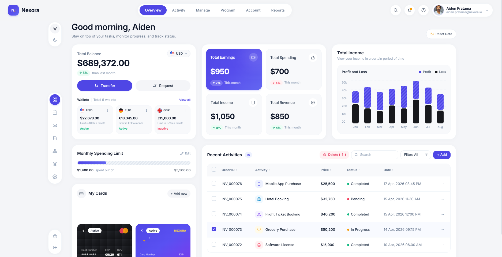

# Nexora — Modern Financial Intelligence Dashboard

A responsive financial dashboard template built with HTML, CSS, and vanilla JavaScript. No build step required.



## Features

- Light/dark theme with persisted preference
- Multi-currency treasury overview (USD, EUR, GBP) with fixed demo conversion rates
- KPI cards, spending-limit progress, wallet & card lists
- 8-month profit/loss chart rendered with HTML and CSS
- Activities table with filtering and transaction actions
- Responsive layout (sidebar collapses on mobile)

## Project structure

```
nexora_financial_dashboard/
├── index.html                 # Page markup
├── README.md
├── LICENSE
├── .gitignore
├── docs/
│   └── preview.png            # Dashboard preview
└── assets/
    ├── css/
    │   └── style.css          # Custom styles & theme tokens
    ├── js/
    │   └── main.js            # State, rendering, interactions
    └── favicon.svg
```

Tailwind CSS is loaded via CDN (no local build). Its inline config lives in the
`<head>` of `index.html`.

This is a frontend demo, not a banking service. Data is stored locally in each
visitor's browser; there is no backend, authentication, shared database, or real
money transfer. Do not enter sensitive financial data. Fonts, the avatar image,
and Tailwind's browser CDN require an internet connection. For production apps,
compile Tailwind to a static stylesheet instead of using its browser CDN.

## Run locally

No dependencies required. Open `index.html` directly in a browser, or serve the
folder for a cleaner URL:

```bash
npx serve .
# or
python -m http.server 8080
```

## Customize

- **Theme colors** — CSS variables in `assets/css/style.css` (`:root` / `html.dark`) and the `tailwind.config` block in `index.html`.
- **Demo data** — `getDefaultState()` and `CHART_DATA` in `assets/js/main.js`.
- **Currency rates** — `CURRENCY_RATES` in `assets/js/main.js`.

## Deploy to GitHub Pages

1. Push this repository to GitHub.
2. `Settings → Pages → Source: Deploy from a branch`.
3. Pick `main` / `(root)` and save. The site goes live at
   `https://<user>.github.io/<repo>/`.

## License

[MIT](LICENSE)
